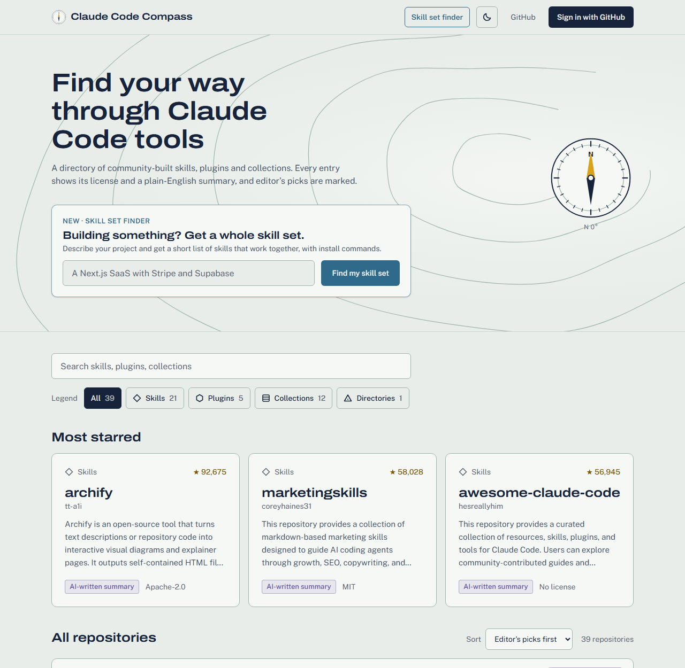
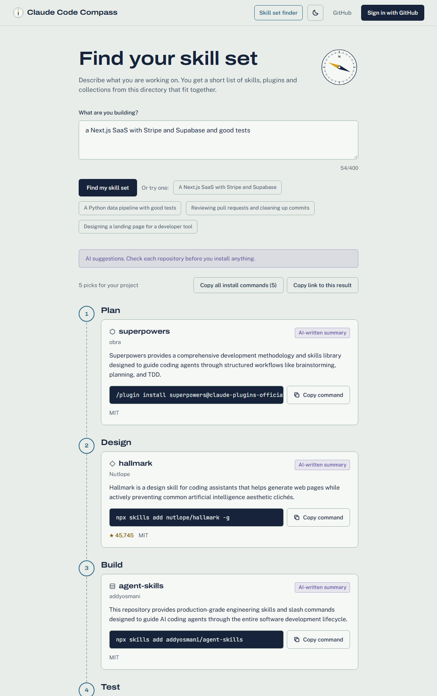
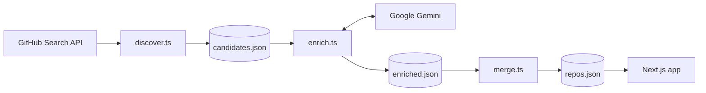
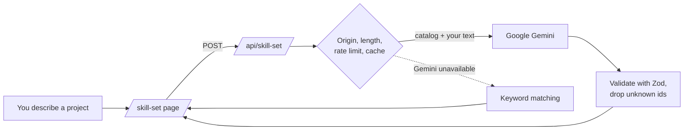
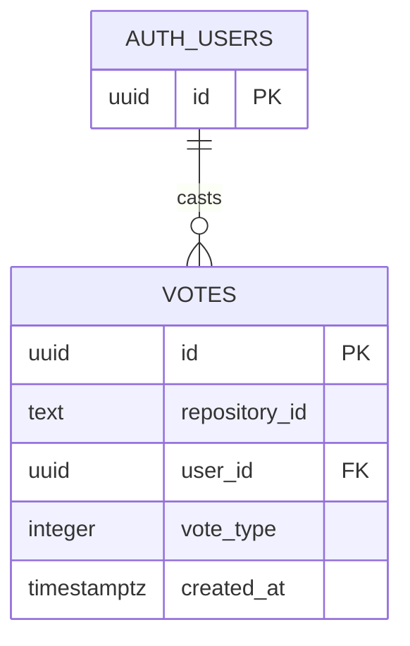
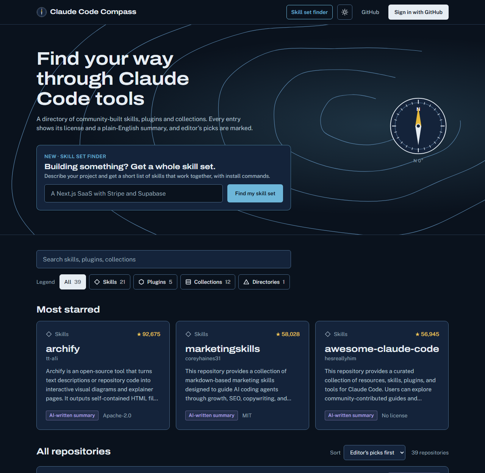
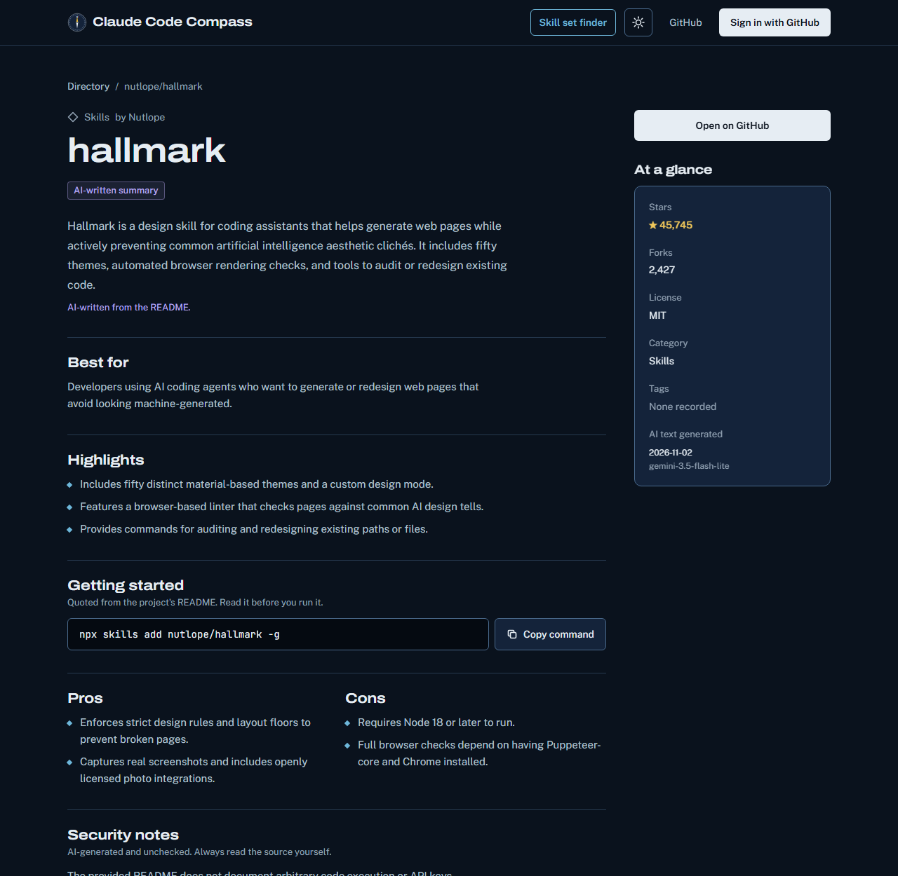
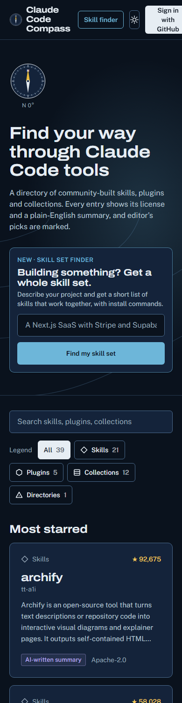

<div align="center">


# Claude Code Compass

**Find your way through Claude Code tools.**

A directory of community-built skills, plugins and collections, with plain-English AI summaries, community votes, and a **Skill Set Finder** that turns "here is what I'm building" into a short list of tools that work together.

[](https://claude-code-compass.vercel.app)

[](https://github.com/apilP77/Claude-code-compass/actions/workflows/ci.yml)
[](https://nextjs.org/)
[](https://react.dev/)
[](https://www.typescriptlang.org/)
[](https://supabase.com/)
[](https://tailwindcss.com/)
[](LICENSE)

[**Live site**](https://claude-code-compass.vercel.app) ·
[**Skill Set Finder**](#-skill-set-finder) ·
[**How it works**](#-how-it-works) ·
[**Run it locally**](#-run-it-locally) ·
[**Contributing**](#-contributing)

<br />



</div>

---

## Why Compass?

Claude Code skills, plugins and collections are scattered across GitHub. It is hard to tell what a project does, whether it is maintained, and what to check before you install it.

Compass puts that in one place: a searchable directory, a readable summary of every entry, its license and install command, community votes, and a finder that recommends a set of tools for your project.

> [!IMPORTANT]
> Summaries and security notes are **written by AI from each project's README** and are labelled as such. They are a starting point, not an endorsement or a safety guarantee. Only entries marked **Editor's pick** have been looked at by a person. Votes are community opinion, not a safety rating. Compass is an independent community project and is **not affiliated with or endorsed by Anthropic**.

## ✨ What you can do

| | |
|---|---|
| 🧭 **Skill Set Finder** | Describe your project and get 3 to 7 tools grouped by role (Plan, Design, Build, Test, Review), each with a reason and a copy-ready install command |
| 🔍 **Search and filter** | Search by name, tag or summary. Filter by category. Sort by editor's picks, stars, newest, name or last checked |
| 📝 **Plain-English summaries** | Gemini reads each README and writes a summary, who it is best for, highlights, pros and cons, security notes and the install command quoted from the README |
| 🗳️ **Community voting** | Sign in with GitHub. One vote per person per repository, change or remove it any time |
| 🏷️ **Honest labels** | *Editor's pick* for entries a person has checked, *AI-written summary* for the rest. Nothing pretends to be verified |
| 🌗 **Light and dark** | A "survey chart" light theme and a "night chart" dark theme, with no flash on load |
| ♿ **Accessible by default** | Keyboard friendly, visible focus, words as well as colour on every status, and no animation for people who ask for reduced motion |

## 🧭 Skill Set Finder

Type what you are building, for example *"A Next.js SaaS with Stripe and Supabase, with good tests"*. You get a short route of tools that fit together, each with why it was picked and how to install it.

<div align="center">

</div>

- **Only real tools.** Gemini may only choose repositories that exist in the directory. Anything else it returns is dropped before you see it.
- **Copy everything.** Copy one install command, all of them at once, or a link that reopens the same result (`/skill-set?q=...`).
- **Works without AI.** If Gemini is down, rate limited, or no key is set, the page falls back to keyword matching and tells you so.
- **Built to resist misuse.** Your text is treated as data, never as instructions. Input is capped, requests are rate limited per visitor, repeat questions are cached, and the API key never leaves the server.

## 🏗️ How it works

### Data pipeline

Repositories flow from GitHub to the site in four scripted stages.



| Stage | Script | What it does |
|---|---|---|
| **Discover** | `scripts/discover.ts` | Finds candidate repos with the GitHub Search API and skips forks, archived and junk repos |
| **Enrich** | `scripts/enrich.ts` | Reads each README and asks Gemini for the summary, best-for, highlights, pros, cons, security notes and install command. Output is validated with Zod and the install command must appear in the README |
| **Merge** | `scripts/merge.ts` | Adds new entries to `data/repos.json` and clears the queue |
| **Serve** | Next.js App Router | Server-rendered search, filters and detail pages |

### Skill Set Finder



### Voting and auth



- **One vote per user per repository**, enforced by a unique `(repository_id, user_id)` constraint.
- **Row-level security** keeps vote rows private to their owner.
- **Aggregate-only reads.** The site reads totals through the `get_repository_vote_score` Postgres function, never raw votes.
- **Server-side checks.** Votes go through `SECURITY DEFINER` functions that validate input and allow at most 10 changes per user per minute.

## 🖼️ A look around

<div align="center">

| Night chart (dark) | Repository detail |
|:---:|:---:|
|  |  |



</div>

The look is documented in [`DESIGN.md`](DESIGN.md): a topographic "survey map" with a live compass whose needle follows your pointer (or your scrolling on a phone), contour lines that drift as you move, and a route layout for finder results. Every motion is switched off for visitors who ask for reduced motion.

## 🧰 Tech stack

| Layer | Technology |
|---|---|
| Framework | Next.js 16 (App Router, Cache Components, partial prerendering), React 19 |
| Language | TypeScript, with runtime validation by Zod |
| Styling | Tailwind CSS v4, CSS variables for the two themes |
| Database and auth | Supabase (Postgres, Row Level Security, GitHub OAuth) |
| AI | Google Gemini through `@google/genai`, with structured JSON output |
| Testing and checks | Vitest, ESLint, `tsc`, GitHub Actions |
| Hosting | Vercel (production from `main`, a preview for every branch) |

## 📁 Project structure

```text
.
├── src/
│   ├── app/              # Routes: home, repo pages, /skill-set, /api/skill-set, /api/votes, auth
│   ├── components/       # UI: compass, hero, search, sort, repo rows, finder, vote buttons
│   └── lib/              # Search, schema, Gemini prompts and validation, rate limiting, helpers
├── scripts/              # discover, enrich and merge pipeline
├── data/                 # candidates.json, enriched.json, repos.json, discovery run logs
├── supabase/migrations/  # 001 votes, 002 rate limits, 003 remove vote
├── docs/                 # logo and screenshots used by this README
├── .github/workflows/    # CI and nightly discovery
└── .githooks/            # commit-msg hook (see Contributing)
```

## 🚀 Run it locally

**You need:** Node.js 20.9 or newer, a Supabase project, a Gemini API key, and (only for discovery) a GitHub token.

```bash
git clone https://github.com/apilP77/Claude-code-compass.git
cd Claude-code-compass
npm install
cp .env.example .env.local    # then fill in the values below
npm run dev                   # http://localhost:3000
```

| Variable | Needed for | Notes |
|---|---|---|
| `NEXT_PUBLIC_SUPABASE_URL` | Voting and sign-in | Public by design |
| `NEXT_PUBLIC_SUPABASE_ANON_KEY` | Voting and sign-in | Public by design; protected by Row Level Security |
| `GEMINI_API_KEY` | Skill Set Finder and enrichment | **Server only.** Never prefix it with `NEXT_PUBLIC_`. Without it the finder uses keyword matching |
| `GITHUB_TOKEN` | Discovery script | Read-only access is enough |
| `GEMINI_MODEL` | Optional | Defaults to `gemini-3.5-flash-lite` |
| `GEMINI_TIMEOUT_MS` | Optional, enrichment | Defaults to `15000`; raise it for very large READMEs |
| `MAX_NEW_REPOS` | Optional, discovery | Between 1 and 5 per run (default 2) |

> [!WARNING]
> Never commit `.env.local` or print its values. It is already in `.gitignore`.

### Set up the database

In the Supabase dashboard open **SQL Editor** and run these files from [`supabase/migrations/`](./supabase/migrations/), in order, pasting each file's *contents*:

1. [`001_votes.sql`](./supabase/migrations/001_votes.sql): the `votes` table, owner-only policies and the public score function
2. [`002_vote_rate_limits.sql`](./supabase/migrations/002_vote_rate_limits.sql): server-side validation and the limit of 10 vote changes per user per minute
3. [`003_remove_vote.sql`](./supabase/migrations/003_remove_vote.sql): lets people remove their vote

Then enable **GitHub** under **Authentication → Providers**. Set your **Site URL**, and add your site and `https://*.vercel.app/**` to the redirect URLs so sign-in works on preview deployments.

### Commands

| Command | What it does |
|---|---|
| `npm run dev` | Start the dev server |
| `npm run build` / `npm start` | Production build and server |
| `npm run typecheck` | Generate route types and run `tsc` |
| `npm run lint` | ESLint |
| `npm test` | Vitest |
| `npm run discover` | Find new candidate repositories |
| `npm run enrich` | Write AI summaries for the candidates (`-- --all` backfills `repos.json`, add `--force` to redo) |
| `npm run merge` | Add enriched candidates to the directory |
| `npm run pipeline` | discover, enrich and merge in one go |

### Automation

A nightly GitHub Action (02:00 Nepal time, also runnable by hand) discovers repositories, enriches them and opens a **pull request**. It never pushes to `main`, and each run adds at most `MAX_NEW_REPOS` entries. It needs the `GEMINI_API_KEY` repository secret.

### Deploying

Import the repo into Vercel and add the environment variables above (`GEMINI_API_KEY` as a sensitive variable, for Production and Preview). `main` deploys to production and every other branch gets its own preview. Variables only apply to deployments built after you add them, so redeploy once.

## 🗺️ Roadmap

Detailed progress lives in [`TODO.md`](TODO.md).

| | Milestone | Status |
|---|---|---|
| ✅ | Curated directory with search, filters, detail pages and CI | Done |
| ✅ | Discovery pipeline with pull-request review | Done |
| ✅ | Voting with GitHub sign-in, change and remove | Done |
| ✅ | AI-written summaries, best-for, highlights and install commands | Done |
| ✅ | Skill Set Finder | Done |
| ✅ | Redesign with light and dark themes and the live compass | Done |
| 🔜 | Vote counts on the home list, and sort by votes | Next |
| 🔜 | Starter kits that work without AI, stale-repository warnings, link previews | Planned |
| 📋 | Submit-a-repo form and moderation, trending views from star snapshots | Planned |

> Votes and GitHub stars are community signals, **never** a safety score.

## 🤝 Contributing

Contributions are welcome. Open an issue first for larger changes, and read [`CONTRIBUTING.md`](CONTRIBUTING.md), [`CODE_OF_CONDUCT.md`](CODE_OF_CONDUCT.md) and [`SECURITY.md`](SECURITY.md).

1. Fork the repo and create a branch: `git checkout -b feat/your-feature` (never work on `main`)
2. Turn on the repo's commit hook once: `git config core.hooksPath .githooks`
3. Before you push, run `npm run typecheck && npm run lint && npm test && npm run build`
4. Open a pull request with a clear description

Found a tool that should be listed? Open an issue with the repository link.

Commit rules for this repository, including for AI coding assistants, are in [`CLAUDE.md`](CLAUDE.md): work on a branch, never commit to `main`, and only a human may be listed as a co-author.

## 📄 License

Released under the [MIT License](LICENSE).

---

<div align="center">

**If Compass helped you find a great tool, consider giving it a ⭐**

</div>
