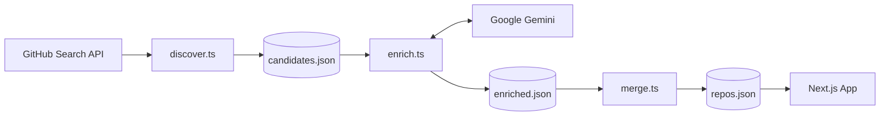
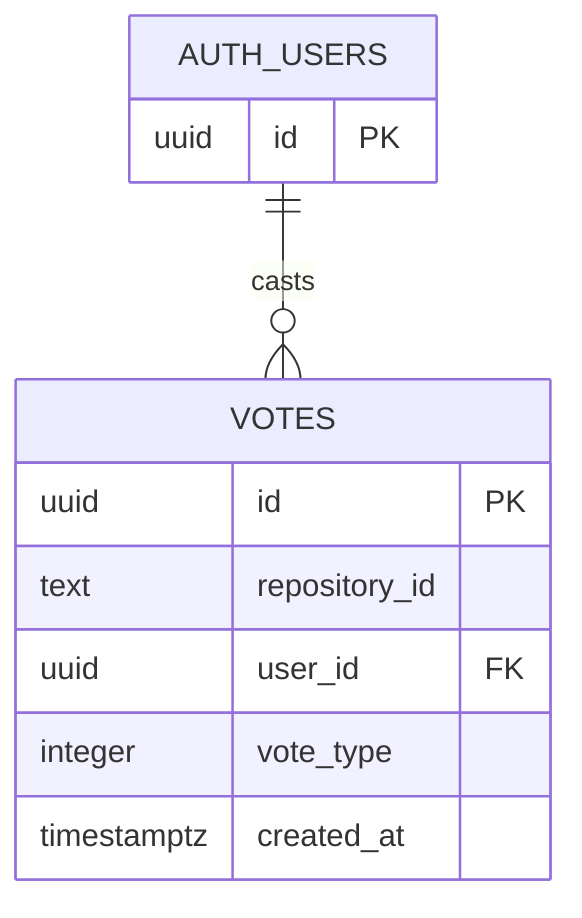

<div align="center">


# 🧭 Claude Code Compass

**Discover, understand, and vote on community-built tools for Claude Code.**

A searchable directory of skills, plugins, and MCP servers, enriched with AI-generated context and ranked by the community.

[](https://claude-code-compass.vercel.app)

[](https://github.com/apilP77/Claude-code-compass/actions/workflows/ci.yml)
[](https://nextjs.org/)
[](https://www.typescriptlang.org/)
[](https://supabase.com/)
[](https://tailwindcss.com/)
[](LICENSE)

[**Live Demo**](https://claude-code-compass.vercel.app) · [**Architecture**](#-architecture) · [**Quick Start**](#-quick-start) · [**Contributing**](#-contributing)

</div>

<!-- Add a screenshot or GIF here:  -->

---

## 🧩 Why Compass?

Claude Code skills, plugins, and MCP servers are scattered across GitHub. It's hard to tell what a project does, whether it's maintained, and what to check before installing it.

**Compass puts it all in one place:** curated repository metadata, clear detail pages, AI-generated pros/cons and security notes, and community votes to surface what's actually useful.

> [!IMPORTANT]
> AI-generated notes and automated discovery are **starting points for human review**, not endorsements or safety guarantees. Entries are labeled *unreviewed* until verified. Votes reflect community opinion; they are not endorsements or safety ratings. Compass is an independent community project and is **not affiliated with or endorsed by Anthropic**.

## ✨ Features

| | |
|---|---|
| 🔍 **Fast search & filters** | Server-rendered search with category filtering |
| 🤖 **AI enrichment pipeline** | Gemini reads each README and produces pros, cons, and security notes |
| 🗳️ **Community voting** | Sign in with GitHub; one vote per user per repository |
| 📄 **Rich detail pages** | Description, category, tags, license, and source links |
| ⚠️ **Transparency first** | Visible "unreviewed" status on automated data |

## 🏗️ Architecture

### 1. Data pipeline

Repositories flow from discovery to the frontend in four scripted stages.



| Stage | Script | Output |
|---|---|---|
| **Discover** | `scripts/discover.ts` | Candidate repos from the GitHub Search API |
| **Enrich** | `scripts/enrich.ts` | AI-generated summaries, pros, cons, security notes |
| **Merge** | `scripts/merge.ts` | New entries appended to the main directory |
| **Serve** | Next.js App Router | Server-rendered search, filters, detail pages |

### 2. Voting & auth



- **One vote per user per repo**, enforced by a unique `(repository_id, user_id)` constraint
- **Row-level security** restricts vote rows to their owner
- **Aggregate-only exposure:** the frontend reads totals through the `get_repository_vote_score` Postgres function, never raw votes

## 🧰 Tech Stack

| Layer | Technology |
|---|---|
| Framework | Next.js 16 (App Router, Cache Components, partial prefetching) |
| Language | TypeScript, validated at runtime with Zod |
| Testing & Lint | Vitest, ESLint |
| Styling | Tailwind CSS |
| Database & Auth | Supabase (Postgres + GitHub OAuth) |
| AI | Google Gemini API |
| Hosting & CI | Vercel, GitHub Actions |

## 📁 Project Structure

```text
.
├── src/          # Next.js app (routes, components, lib)
├── scripts/      # discover → enrich → merge pipeline
├── data/         # candidates.json, enriched.json, repos.json
├── public/       # static assets
└── .github/      # CI workflows
```

## 🚀 Quick Start

**Prerequisites:** Node.js 20+, a Supabase project (GitHub Auth, `votes` table, RLS policies, `get_repository_vote_score` function), a GitHub token, and a Gemini API key.

```bash
git clone https://github.com/apilP77/Claude-code-compass.git
cd Claude-code-compass
npm install
```

Create `.env.local` in the project root (never commit it):

```bash
NEXT_PUBLIC_SUPABASE_URL=https://YOUR_PROJECT.supabase.co
NEXT_PUBLIC_SUPABASE_ANON_KEY=YOUR_SUPABASE_ANON_KEY
GITHUB_TOKEN=YOUR_GITHUB_TOKEN        # discovery
GEMINI_API_KEY=YOUR_GEMINI_API_KEY    # enrichment
```

The Supabase variables are used by the app. `GITHUB_TOKEN` is needed by discovery, and `GEMINI_API_KEY` is needed by enrichment. Use valid, unrevoked credentials and keep all secrets private.

### Configure the voting database

Apply [`supabase/migrations/001_votes.sql`](./supabase/migrations/001_votes.sql) to your Supabase project. In the Supabase Dashboard, open **SQL Editor**, paste the migration contents, and run it. It creates the `votes` table, owner-only row policies, and the public aggregate score function. Configure GitHub as a provider under **Authentication → Providers** as well.

Apply [`supabase/migrations/002_vote_rate_limits.sql`](./supabase/migrations/002_vote_rate_limits.sql) the same way to enable server-side vote validation and the limit of 10 vote changes per user per minute.

```bash
npm run dev    # → http://localhost:3000
```

<details>
<summary><b>Run the data pipeline</b></summary>

<br />

```bash
npx tsx scripts/discover.ts   # find candidates
npx tsx scripts/enrich.ts     # AI-enrich (up to 2 per run by default)
npx tsx scripts/merge.ts      # merge into repos.json, clear queue
```

Review candidate and enrichment output before merging into the main directory.

</details>

### Automation

Nightly discovery runs at 02:00 Nepal time and can also be started manually from GitHub Actions. It opens a pull request for new repositories; it never pushes discoveries directly to `main`. Configure the `GEMINI_API_KEY` repository secret. Each run adds at most two repositories by default; `MAX_NEW_REPOS` can be set from 1 to 5.

<details>
<summary><b>Project checks</b></summary>

<br />

```bash
npm run typecheck
npm run lint
npm run test
npm run build
```

</details>

## 🗺️ Roadmap

Progress is tracked in [`TODO.md`](TODO.md).

| Milestone | Scope | Status |
|---|---|---|
| **M1: Curated directory** | Search, filters, detail pages, editorial template, CI, deploy | 🚧 In progress |
| **M2: Discovery** | GitHub API client, dedup, `unreviewed` labeling, maintainer review flow | 🚧 In progress |
| **M3: Voting** | Postgres + Supabase Auth, one vote per user, change/remove votes | 🚧 In progress |
| **M4: Scheduled discovery** | GitHub Actions cron, *New* / *Recently Updated* / *Most Starred* views, snapshots | 📋 Planned |
| **Trending** | Star-growth formula, shown only once ~4 weeks of snapshots exist | 📋 Planned |
| **Community** | `CONTRIBUTING.md`, issue templates, submission form, moderation policy | 📋 Planned |

> Votes and GitHub stars are community signals, **never** a safety score.

## 🤝 Contributing

Contributions are welcome. Open an issue to discuss larger changes, then:

1. Fork the repo and create a branch: `git checkout -b feat/your-feature`
2. Run `npm run typecheck && npm run lint && npm run test`
3. Open a pull request with a clear description

Found a tool that should be listed? Open an issue with the repository link.

## 📄 License

Released under the [MIT License](LICENSE).

---

<div align="center">

**If Compass helped you find a great tool, consider giving it a ⭐**

</div>
