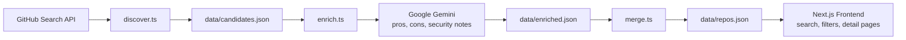
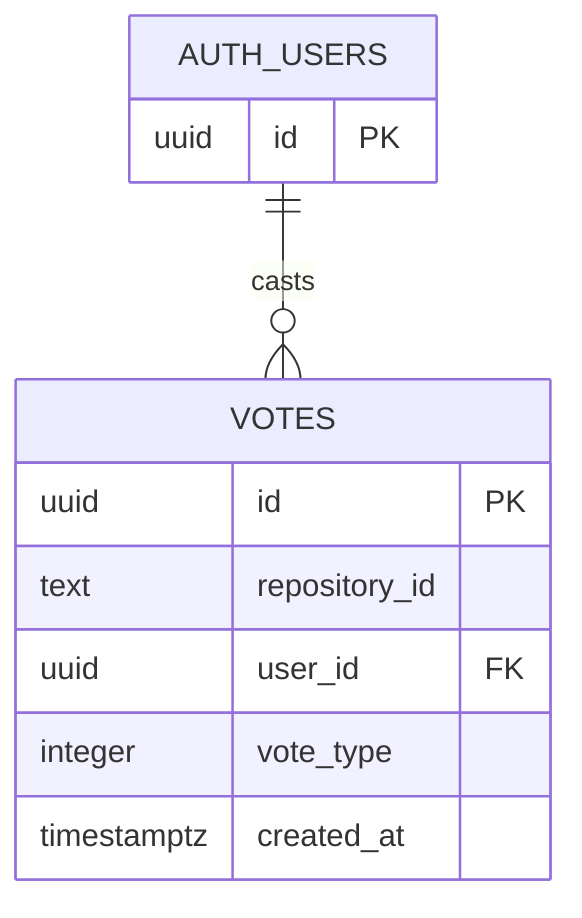

# Claude Code Compass 🧭

**Discover, understand, and vote on community-built tools for Claude Code.**

[](https://nextjs.org/)
[](https://supabase.com/)
[](https://github.com/apilP77/Claude-code-compass/actions/workflows/ci.yml)

## 🧩 The Problem

Claude Code skills, plugins, MCP servers, and related tools are scattered across GitHub and community sources. Finding the right project is difficult, and it can be hard to assess what it does, whether it is maintained, and what to review before using it.

## 🧭 The Solution

Claude Code Compass is a searchable directory of community-built Claude Code resources. It curates repository metadata, presents detail pages with available licensing and AI-generated context, and lets signed-in community members vote on listings.

Automated discovery and AI-generated notes are starting points for human review—not endorsements or guarantees of safety. Claude Code Compass is an independent community project and is not affiliated with or endorsed by Anthropic.

## 🏗️ System Architecture

### Repository discovery and enrichment



### Voting and authentication



The `votes` table enforces one vote per repository and user with a unique constraint on `(repository_id, user_id)`. Row-level security restricts individual vote access to the owning user. The `get_repository_vote_score` Postgres function exposes only an aggregate score to the frontend.

## ✨ Features

- 🔍 Fast, server-rendered search and category filtering.
- 🤖 AI-powered repository discovery and data-enrichment pipeline.
- 🗳️ Community voting with GitHub Auth via Supabase.
- 📄 Repository detail pages with descriptions, categories, tags, licenses, and source links.
- ⚠️ Visible unreviewed status so automated data is not mistaken for editorial verification.

## 🧰 Tech Stack

- **Next.js 16** — App Router and server-rendered pages
- **Tailwind CSS** — responsive UI styling
- **Supabase** — Postgres database and GitHub authentication
- **Google Gemini API** — README-based candidate enrichment
- **TypeScript** — application and pipeline scripts
- **Zod** — runtime validation for repository data

## 🚀 How to run locally

### Prerequisites

- Node.js 20 or later and npm
- Supabase project configured with GitHub Auth, the `votes` table, RLS policies, and the `get_repository_vote_score` function
- GitHub personal access token for discovery
- Gemini API key for enrichment

### Install and configure

1. Clone the repository and enter its directory.

   ```bash
   git clone https://github.com/apilP77/Claude-code-compass.git
   cd Claude-code-compass
   ```

2. Install dependencies.

   ```bash
   npm install
   ```

3. Create a root-level `.env.local` file with your own credentials. Do not commit this file.

   ```dotenv
   NEXT_PUBLIC_SUPABASE_URL=https://YOUR_PROJECT.supabase.co
   NEXT_PUBLIC_SUPABASE_ANON_KEY=YOUR_SUPABASE_ANON_KEY
   GITHUB_TOKEN=YOUR_GITHUB_TOKEN
   GEMINI_API_KEY=YOUR_GEMINI_API_KEY
   ```

### Configure the voting database

Apply [`supabase/migrations/001_votes.sql`](./supabase/migrations/001_votes.sql) in the Supabase Dashboard SQL Editor. It creates the votes table, owner-only row policies, and aggregate score function. Configure GitHub in Authentication > Providers as well.

Apply [`supabase/migrations/002_vote_rate_limits.sql`](./supabase/migrations/002_vote_rate_limits.sql) in the Supabase Dashboard SQL Editor. It enables server-side vote validation and limits each user to 10 vote mutations per minute.

   The Supabase variables are used by the app. `GITHUB_TOKEN` is needed by discovery, and `GEMINI_API_KEY` is needed by enrichment. Use valid, unrevoked credentials and keep all secrets private.

4. Start the development server.

   ```bash
   npm run dev
   ```

   Open the local URL printed by Next.js (usually `http://localhost:3000`).

### Run the data pipeline

Run these commands from the repository root, in order:

```bash
npx tsx scripts/discover.ts
npx tsx scripts/enrich.ts
npx tsx scripts/merge.ts
```

Discovery writes candidates to `data/candidates.json`; enrichment processes up to three candidates into `data/enriched.json`; merge adds new entries to `data/repos.json` and clears the enriched queue. Review generated candidate and enrichment data before merging it into the main directory.

### Project checks

```bash
npm run typecheck
npm run lint
npm run test
npm run build
```
